# Stage 6: Ports Plan

This document defines the Stage 6 userland ports architecture for `filc-patches`:
the initial core package set and dependency graph, upstream provenance and policy
classification against pinned Fil-C (`cede3de02b42`), the declarative recipe
format under `ports/`, the CI execution strategy, and the package-status view
design for `filc-live`.

All work follows the [Ports policy](../README.md#ports-policy) in `README.md`:
fix toolchain gaps first, prefer build options over source patches, keep
necessary package patches minimal and upstreamable, audit adopted Fil-C patches
for hidden toolchain gaps, and continuously drive patch count and patch size
down.

---

## 1. Policy Classification Legend

Every port in the core set is classified under one primary policy class:

| Class | Meaning | Target Action |
|---|---|---|
| `P0-Clean` | Builds unmodified from the upstream release tarball (zero source patches). | Keep at 0 patches; verify build + test suite continuously. |
| `P1-Toolchain` | Existing Fil-C patch works around a compiler, driver, runtime, or libc gap (e.g. `-Wl,--version-script=` rejection or `libtool` symbol prefix handling). | Fix once in the Fil-C toolchain (`llvm/`, `runtime/filc/`, `libc/musl/`) to drop package patches to 0. |
| `P2-Package` | Genuinely unsafe or non-portable pattern inside the package (pointer↔integer casts, custom allocator, inline asm, racy non-atomic capability loads, header macro clash). | Maintain a minimal, documented, upstreamable patch with rationale. |
| `P3-BuildOpt` | Solvable through configure/CMake/make flags or build-env options (e.g. `--without-bash-malloc`, `--disable-assembly`, `--without-pymalloc`, `--without-jit`). | Encode in recipe build options; remove redundant source patches. |
| `P4-Audit` | Large adopted Fil-C port patch (crypto asm forwarding, FFI ABI, multi-file runtime/libc adaptations). | Adopt as starting point with provenance; decompose and audit for hidden `P1-Toolchain` or `P3-BuildOpt` wins. |

---

## 2. Core Package Set (47 Packages) & Dependency Graph

The initial corpus comprises **47 packages** derived from the musl-based Fil-C
build set at pinned commit `cede3de02b42`, organized into six strictly acyclic
dependency tiers.

### 2.1 Dependency Graph (DAG)

```mermaid
flowchart TD
  TC["Stage 5 Toolchain (clang, lld, libpizlo, usermusl, libc++)"]

  subgraph T0["Tier 0: Bootstrap & Core Compression/Hash"]
    pkgconf & zlib & bzip2 & xz & lz4 & xxhash & blake3 & brotli
  end

  subgraph T1["Tier 1: Base Libraries"]
    zstd & expat & libffi & pcre2 & libunistring & libidn2 & attr & yaml & gmp
  end

  subgraph T2["Tier 2: Terminal, Event, XML & Data"]
    ncurses & libedit & libevent & libuv & libxml2 & icu & sqlite
  end

  subgraph T3["Tier 3: Crypto, Networking & Archives"]
    openssl & nghttp2 & curl & libarchive & rsync & openssh
  end

  subgraph T4["Tier 4: Shells, POSIX/GNU CLI & System Tools"]
    dash & bash & gzip & patch & m4 & sed & grep & coreutils & tmux & util_linux["util-linux"] & patchelf
  end

  subgraph T5["Tier 5: Languages & Developer Tools"]
    lua & bison & git & cmake & python & ruby
  end

  TC --> T0
  zlib --> zstd
  lz4 --> zstd
  xz --> zstd
  pkgconf --> libffi
  pkgconf --> pcre2
  libunistring --> libidn2
  pcre2 --> ncurses
  ncurses --> libedit
  zlib --> libxml2
  xz --> libxml2
  pkgconf --> icu
  zlib --> sqlite
  libedit --> sqlite
  zlib --> openssl
  zstd --> openssl
  zlib --> nghttp2
  openssl --> nghttp2
  openssl --> curl
  nghttp2 --> curl
  zlib --> curl
  zstd --> curl
  brotli --> curl
  libidn2 --> curl
  zlib --> libarchive
  bzip2 --> libarchive
  xz --> libarchive
  lz4 --> libarchive
  zstd --> libarchive
  openssl --> libarchive
  zlib --> rsync
  lz4 --> rsync
  zstd --> rsync
  xxhash --> rsync
  openssl --> rsync
  zlib --> openssh
  openssl --> openssh
  libedit --> openssh
  ncurses --> bash
  libevent --> tmux
  ncurses --> tmux
  attr --> coreutils
  gmp --> coreutils
  openssl --> coreutils
  ncurses --> util_linux
  zlib --> util_linux
  pcre2 --> grep
  m4 --> bison
  libedit --> lua
  zlib --> git
  curl --> git
  expat --> git
  openssl --> git
  pcre2 --> git
  curl --> cmake
  libarchive --> cmake
  libuv --> cmake
  expat --> cmake
  zlib --> cmake
  bzip2 --> cmake
  xz --> cmake
  zstd --> cmake
  openssl --> python
  libffi --> python
  zlib --> python
  bzip2 --> python
  xz --> python
  expat --> python
  sqlite --> python
  ncurses --> python
  libedit --> python
  openssl --> ruby
  libffi --> ruby
  zlib --> ruby
  yaml --> ruby
  ncurses --> ruby
  libedit --> ruby
```



### 2.2 Complete 47-Package Inventory & Policy Audit

All upstream versions, SHA-256 checksums, and Fil-C port patch sizes below are
verified directly against the pinned Fil-C tree (`cede3de02b42`). Packages
imported as unpacked legacy directories in Fil-C (without a `.projeny` archive
hash) are explicitly marked `pin on fetch` so checksums are recorded from
verified upstream release tarballs when each recipe is added.

#### Tier 0: Bootstrap & Core Compression/Hash (8 packages)

| # | Package | Deps | Upstream Version & Source | SHA-256 (12-char) | Fil-C `cede3de02b42` Patch | Policy Class | Policy Rationale |
|---|---|---|---|---|---|---|---|
| 1 | `pkgconf` | none | `pkgconf-3.0.10` (github.com/pkgconf/pkgconf) | `c13143cee8ad` | 2 files (`+9/-9`) | `P1-Toolchain` | Patches `configure`/`Makefile.in` for `pizlonated_` symbol prefix; test `P3` env override or `P1` driver/nm fix. |
| 2 | `zlib` | none | `zlib-1.4` (zlib.net / github.com/madler/zlib) | `caa1a355ab78` | 3 files (`+6/-11`) | `P3-BuildOpt` | Disables ARM CRC32 asm and adjusts `zconf.h` type; check `CFLAGS` / configure options before carrying a patch. |
| 3 | `bzip2` | none | `bzip2` (upstream `fbc4b11da543`) | pin on fetch | 0 files (pristine import) | `P0-Clean` | Builds unmodified upstream. |
| 4 | `xz` | none | `xz-5.8.4` (tukaani.org / github.com/tukaani-project/xz) | `4ce24038fd42` | 6 files (`+19/-6`) | `P2-Package` | Small CRC/range-decoder portability tweaks (`crc32_fast.c`, `range_decoder.h`); audit against `--disable-assembler` (`P3`). |
| 5 | `lz4` | none | `lz4-1.11.0` (github.com/lz4/lz4) | `cd810aa68744` | 1 file (`+2/-1`) | `P3-BuildOpt` | Only `lib/Makefile` flag adjustment; pass via `MAKE_ARGS` to reach 0 patches. |
| 6 | `xxhash` | none | `xxHash-0.8.4` (github.com/Cyan4973/xxHash) | `0d1be0dc1089` | 1 file (`+12/-2`) | `P2-Package` | Replaces inline x86 `xgetbv`/`cpuid` asm in `xxh_x86dispatch.c` with `zxgetbv()`/`__get_cpuid_count()`; small upstreamable patch. |
| 7 | `blake3` | none | `BLAKE3-1.8.7` (github.com/BLAKE3-team/BLAKE3) | `c6782a28842b` | 0 files (`+0/-0`) | `P0-Clean` | Builds unmodified upstream (C implementation). |
| 8 | `brotli` | none | `brotli-1.2.1` (github.com/google/brotli) | `1fa1b8b9120e` | 0 files (`+0/-0`) | `P0-Clean` | Builds unmodified upstream. |

#### Tier 1: Base Libraries (9 packages)

| # | Package | Deps | Upstream Version & Source | SHA-256 (12-char) | Fil-C `cede3de02b42` Patch | Policy Class | Policy Rationale |
|---|---|---|---|---|---|---|---|
| 9 | `zstd` | `zlib`, `lz4`, `xz` | `zstd-1.5.7` (github.com/facebook/zstd) | pin on fetch | small delta (`fileio.c`, asm) | `P3-BuildOpt` | Prefer `ZSTD_LEGACY_SUPPORT` / `-DZSTD_DISABLE_ASM` build flags; keep only minimal C fixes if still needed. |
| 10 | `expat` | none | `expat-2.7.1` (github.com/libexpat/libexpat) | pin on fetch | 0 source changes (autotools only) | `P0-Clean` | Pristine upstream C library. |
| 11 | `libffi` | `pkgconf` | `libffi-3.8.0` (github.com/libffi/libffi) | `7da3e2d9a171` | 13 files (`+565/-13`) | `P4-Audit` | Implements `FFI_FILC` ABI for x86_64/aarch64 (inherently ABI-level; genuinely required `P2`/`P4` runtime bridge). |
| 12 | `pcre2` | `pkgconf` | `pcre2-10.49` (github.com/PCRE2Project/pcre2) | `a1b29c27e5d4` | 2 test files (`+72/-69`) | `P3-BuildOpt` | Library itself is 0-patch with `--disable-jit`; only `RunGrepTest` adjustments to audit. |
| 13 | `libunistring` | none | `libunistring-1.5` (ftpmirror.gnu.org/libunistring) | `be8cb96c928d` | 0 files (`+0/-0`) | `P0-Clean` | Builds unmodified upstream. |
| 14 | `libidn2` | `libunistring` | `libidn2-2.3.8` (ftp.gnu.org/gnu/libidn) | `f557911bf617` | 1 file (`+1/-1`) | `P1-Toolchain` | Single-line `-Wl,--version-script` -> `-Wc,--version-script`; drops to 0 patches once Clang driver accepts `-Wl,--version-script`. |
| 15 | `attr` | none | `attr-2.6.0` (download.savannah.nongnu.org/releases/attr) | `d42fa3745131` | 1 file (`+1/-1`) | `P1-Toolchain` | Same single-line `-Wl,--version-script` workaround in `Makefile.in`; drops to 0 patches with the driver fix. |
| 16 | `yaml` | none | `yaml-0.2.5` (github.com/yaml/libyaml) | pin on fetch | 0 source changes | `P0-Clean` | Builds unmodified upstream (`--enable-shared`). |
| 17 | `gmp` | none | `gmp-6.3.0` (gmplib.org / ftp.gnu.org/gnu/gmp) | pin on fetch | small delta + `--disable-assembly` | `P3-BuildOpt` | `--disable-assembly` handles asm; audit remaining Fil-C delta (`1e8b2b9d`) for `P1`/`P2`. |

#### Tier 2: Terminal, Event, XML & Data (7 packages)

| # | Package | Deps | Upstream Version & Source | SHA-256 (12-char) | Fil-C `cede3de02b42` Patch | Policy Class | Policy Rationale |
|---|---|---|---|---|---|---|---|
| 18 | `ncurses` | `pcre2` | `ncurses-6.6` (ftp.gnu.org/gnu/ncurses) | pin on fetch | 0 files (pristine import) | `P0-Clean` | Builds unmodified upstream with `--with-shared --without-ada --enable-pc-files`. |
| 19 | `libedit` | `ncurses` | `libedit-20260512-3.1` (thrysoee.dk/editline) | `432d5e7ea8b0` | 1 file (`+2/-1`) | `P2-Package` | Skips Linux-specific `wchar_t`/ISO-10646 `#error` in `src/chartype.h` (matching BSD branch); trivial upstreamable patch. |
| 20 | `libevent` | none | `libevent-2.1.13` (github.com/libevent/libevent) | pin on fetch | small delta (`ee826772`) | `P2-Package` | Audit delta against musl/Fil-C pointer casts; isolate minimal upstreamable patch. |
| 21 | `libuv` | none | `libuv-1.53.0` (dist.libuv.org/dist/v1.53.0) | `bac496ea32e6` | 12 files (`+79/-46`) | `P2-Package` | Unix syscall/proctitle/process pointer handling (`src/unix/{fs,linux,process,proctitle,signal}.c`); audit for `P1` libc gaps. |
| 22 | `libxml2` | `zlib`, `xz` | `libxml2-2.15.4` (download.gnome.org/sources/libxml2) | `98087fd181d9` | 1 file (`+1/-1`) | `P2-Package` | Marks `xmlCatalogEntry.children` `_Atomic` in `catalog.c` to fix a real unsynchronized concurrent pointer load; ideal upstream fix. |
| 23 | `icu` | `pkgconf` | `icu4c-79.1` (github.com/unicode-org/icu) | `30136d14852f` | 7 files (`+76/-3`) | `P2-Package` | Capability-safe converter clone, aliasing barrier, and C-array data loading instead of raw `.S` blobs. |
| 24 | `sqlite` | `zlib`, `libedit` | `sqlite` (upstream `1aa94b58213b`) | pin on fetch | minimal delta (`5eb6ea2a` reverted most) | `P2-Package` | Fil-C already reverted most SQLite patches; verify how close upstream SQLite is to 0 patches. |

#### Tier 3: Crypto, Networking & Archives (6 packages)

| # | Package | Deps | Upstream Version & Source | SHA-256 (12-char) | Fil-C `cede3de02b42` Patch | Policy Class | Policy Rationale |
|---|---|---|---|---|---|---|---|
| 25 | `openssl` | `zlib`, `zstd` | `openssl-3.6.5` (github.com/openssl/openssl) | `1f7fe0f6b2d9` | 78 files (`+2367/-756`) | `P4-Audit` | Constant-time crypto + asm-call wrappers (`zunsafe-openssl3`); `-Wl,--version-script` hunk in `shared-info.pl` becomes `P1-Toolchain`. |
| 26 | `nghttp2` | `zlib`, `openssl` | `nghttp2-1.71.0` (github.com/nghttp2/nghttp2) | `cbcd0fe41e54` | 0 files (`+0/-0`) | `P0-Clean` | Builds unmodified upstream. |
| 27 | `curl` | `openssl`, `nghttp2`, `zlib`, `zstd`, `brotli`, `libidn2` | `curl-8.23.0` (curl.se/download) | `c048df2e6138` | 9 files (`+191/-54`) | `P4-Audit` | Contains `libtool` `pizlonated_` hunks (`P1`/`P3`) plus CA bundle/runtime wiring; audit to shrink substantially. |
| 28 | `libarchive` | `zlib`, `bzip2`, `xz`, `lz4`, `zstd`, `openssl` | `libarchive-3.7.4` (github.com/libarchive/libarchive) | pin on fetch | small delta (`f03f8684`, `500b0865`) | `P3-BuildOpt` | Check unmodified upstream build with `--without-expat --without-nettle --without-xml2`. |
| 29 | `rsync` | `zlib`, `lz4`, `zstd`, `xxhash`, `openssl` | `rsync-3.5.2` (github.com/RsyncProject/rsync) | `d1158c225003` | 0 files (`+0/-0`) | `P0-Clean` | Builds unmodified upstream. |
| 30 | `openssh` | `zlib`, `openssl`, `libedit` | `openssh-10.6p2` (cdn.openbsd.org/pub/OpenBSD/OpenSSH/portable) | `5ac4ab37a02f` | 52 files (`+3626/-197`) | `P4-Audit` | High-value security target; audit sandboxing, privilege separation, and `Makefile.in` changes for `P1`/`P3` splits. |

#### Tier 4: Shells, POSIX/GNU CLI & System Tools (11 packages)

| # | Package | Deps | Upstream Version & Source | SHA-256 (12-char) | Fil-C `cede3de02b42` Patch | Policy Class | Policy Rationale |
|---|---|---|---|---|---|---|---|
| 31 | `dash` | none | `dash-0.5.13.5` (gondor.apana.org.au/~herbert/dash/files) | `7871678c86c4` | 1 file (`+1/-1`) | `P1-Toolchain` | Uses `fork` instead of `vfork` in `src/jobs.c`; evaluate `vfork` semantics in `usermusl`/`libpizlo` or keep 1-line `P2` patch. |
| 32 | `bash` | `ncurses` | `bash-5.3` (ftp.gnu.org/gnu/bash) | pin on fetch | small delta (`15d13b23`) + `--without-bash-malloc` | `P3-BuildOpt` | `--without-bash-malloc` eliminates custom allocator; audit remaining `15d13b23` hunks. |
| 33 | `gzip` | none | `gzip-1.15` (ftp.gnu.org/gnu/gzip) | `3cbe9101598e` | 1 file (`+7/-0`) | `P2-Package` | Moves `#include <signal.h>` before `gzip.h` to avoid macro clash (`head`); clean upstreamable fix. |
| 34 | `patch` | none | `patch-2.8.1` (ftp.gnu.org/gnu/patch) | `24158fd209ad` | 0 files (`+0/-0`) | `P0-Clean` | Builds unmodified upstream. |
| 35 | `m4` | none | `m4-1.4.21` (ftpmirror.gnu.org/m4) | `a23e9503084f` | 20 files (`+82/-56`) | `P2-Package` | Gnulib `obstack` + `fpucw.h` (`__FILC__`) + `sigsegv`; reusable gnulib patch across GNU tools. |
| 36 | `sed` | none | `sed-4.10` (ftp.gnu.org/gnu/sed) | pin on fetch | small delta (`7e2f54ae`, `8790b468`) | `P2-Package` | Gnulib `obstack` + huge-alloc test skip under Fil-C. |
| 37 | `grep` | `pcre2` | `grep-3.12` (ftp.gnu.org/gnu/grep) | pin on fetch | small delta (`496072a5`) | `P2-Package` | Gnulib `obstack` / pointer arithmetic audit. |
| 38 | `coreutils` | `attr`, `gmp`, `openssl` | `coreutils-9.12` (ftp.gnu.org/gnu/coreutils) | `a48019855973` | 11 files (`+6063/-4978`, incl. i18n) | `P4-Audit` | Separate Fil-C-specific hunks (`obstack`, `sort.c`, `pr.c`) from distro i18n patch (which is not needed for Fil-C correctness). |
| 39 | `tmux` | `libevent`, `ncurses` | `tmux-3.8` (github.com/tmux/tmux) | `f948bad3444d` | 0 files (`+0/-0`) | `P0-Clean` | Builds unmodified upstream. |
| 40 | `util-linux` | `ncurses`, `zlib` | `util-linux-2.42.4` (kernel.org/pub/linux/utils/util-linux) | `f469475f55e5` | 3 files (`+19/-11`) | `P1-Toolchain` | Two of three files (`Makefile.in`, `configure`) are `-Wl,--version-script` (`P1`); leaves only `hook_mount.c` (`P2`). |
| 41 | `patchelf` | none | `patchelf-0.19.3` (github.com/NixOS/patchelf) | `8c90a38f8900` | 0 files (`+0/-0`) | `P0-Clean` | Builds unmodified upstream (upstream 0.19.3 absorbed the pointer derivation fix). |

#### Tier 5: Languages & Developer Tools (6 packages)

| # | Package | Deps | Upstream Version & Source | SHA-256 (12-char) | Fil-C `cede3de02b42` Patch | Policy Class | Policy Rationale |
|---|---|---|---|---|---|---|---|
| 42 | `lua` | `libedit` | `lua-5.4.7` (lua.org/ftp) | pin on fetch | small delta (`5c1a31fd`) | `P2-Package` | Small pointer/tagged-value audit (`lobject.h`/`lgc.c`); high-value interpreter smoke target. |
| 43 | `bison` | `m4` | `bison-3.8.2` (ftp.gnu.org/gnu/bison) | pin on fetch | small delta (gnulib `obstack`) | `P2-Package` | Shares the gnulib `obstack` pattern; needed to build downstream parsers. |
| 44 | `git` | `zlib`, `curl`, `expat`, `openssl`, `pcre2` | `git-2.56.0` (kernel.org/pub/software/scm/git) | `596b02fea3d6` | 24 files (`+74/-96`) | `P2-Package` | Three targeted Fil-C fixes (`parse-options` `defval` pointer-in-`intptr_t` cast, etc.); cleanly upstreamable. |
| 45 | `cmake` | `curl`, `libarchive`, `libuv`, `expat`, `zlib`, `bzip2`, `xz`, `zstd`, `openssl` | `cmake-3.30.2` (github.com/Kitware/CMake) | pin on fetch | minimal (`fc54fc58` curl macro fix) | `P3-BuildOpt` | Builds against system Fil-C libs (`--system-libs --bootstrap-system-libuv`); curl compatibility fix is upstream-relevant. |
| 46 | `python` | `openssl`, `libffi`, `zlib`, `bzip2`, `xz`, `expat`, `sqlite`, `ncurses`, `libedit` | `Python-3.12.5` (python.org/ftp/python) | pin on fetch | delta (`4d81217a`) + `--without-pymalloc --without-mimalloc --without-freelists` | `P4-Audit` | Disables custom allocators via `P3` flags; audit `4d81217a` for remaining pointer-tagging / C-API assumptions. |
| 47 | `ruby` | `openssl`, `libffi`, `zlib`, `yaml`, `ncurses`, `libedit` | `ruby-3.3.10` (cache.ruby-lang.org/pub/ruby) | pin on fetch | multi-commit delta (`50531d7e`) + `--disable-yjit --disable-rjit --without-jit` | `P4-Audit` | Disables JIT via `P3` flags; audit GC/VALUE pointer tagging and stack-scanning changes. |

### 2.3 High-Leverage Toolchain-First Wins (Policy Rules 1, 3 & 4)

Before importing package patches wholesale, four targeted improvements pay off
across multiple packages at once:

1. **Clang driver `-Wl,--version-script=` handling (`P1-Toolchain`):**
   Accepting or rewriting `-Wl,--version-script=` in `llvm/06a-clang-driver-filc-core.patch`
   immediately eliminates package patches for `attr` and `libidn2`, and removes
   build-file hunks from `util-linux` and `openssl`.
2. **`libtool` `pizlonated_` symbol-prefix handling (`P1-Toolchain` / `P3-BuildOpt`):**
   Providing a clean `lt_cv_sys_global_symbol_pipe` / `nm` wrapper or driver
   support removes `configure` patches from `pkgconf` and parts of `curl`.
3. **Shared gnulib `obstack` capability-safe patch (`P2-Package`, upstreamable):**
   `m4`, `sed`, `grep`, `coreutils`, and `bison` share the same gnulib `obstack`
   chunk-allocation issue; one clean, documented upstreamable patch covers all
   of them.
4. **Drop non-Fil-C distro patches (`P4-Audit`):**
   For `coreutils`, stripping the unrelated distro i18n patch (`~10k` lines)
   isolates only the small genuine Fil-C delta.

#### Port Audit Class Note: `nm` / ELF Symbol Heuristics (`pizlonated_` and `filc_*`)

Fil-C's `FilPizlonator` pass prefixes ELF symbols for C globals and functions
with `pizlonated_` (for example `pizlonated_boot_XS__Other` instead of
`boot_XS__Other`) and emits runtime helper references such as
`filc_allocate_without_exiting`. Any build system, test suite, or packaging
check that runs `nm`, `readelf`, or `objdump` and filters output with regexes
will silently miss symbols or trigger false positives unless audited:

- **`libtool` symbol export pipes** (`lt_cv_sys_global_symbol_pipe`, seen in
  `pkgconf`, `curl`, and autotools shared libraries).
- **Perl `ExtUtils::MakeMaker`** (`ExtUtils::MM_Unix::xs_static_lib_is_xs`
  matching `` `nm $libfile` =~ /\b_?boot_/ ``, which skipped static XS archives
  under `LINKTYPE => 'static'` until extended to `/\b(?:pizlonated_|_)?boot_/`).
- **PostgreSQL `libpq`** (`libpq-refs-stamp` grepping `nm -A -u` for `exit`,
  which false-positives on `filc_allocate_without_exiting`).
- **Python `setuptools` / extension builders, custom export-map scripts, and
  linker-script generators** that parse `nm` output directly.

Every new port pre-flight audit should grep the upstream build and test files
for `nm `, `readelf`, `objdump`, `global_symbol_pipe`, and symbol-name regexes.

### 2.4 Initial Policy Metrics Baseline (47 Packages)

- **`P0-Clean` (0 patches already):** 12 packages (`25.5%`): `bzip2`, `blake3`,
  `brotli`, `expat`, `libunistring`, `yaml`, `ncurses`, `nghttp2`, `rsync`,
  `patch`, `tmux`, `patchelf`.
- **`P1-Toolchain` candidates:** 5 packages (`10.6%`): `pkgconf`, `libidn2`,
  `attr`, `dash`, `util-linux` (expected to drop to 0 patches or 1-file minimal
  deltas after Clang driver/libc fixes).
- **`P3-BuildOpt` candidates:** 8 packages (`17.0%`): `zlib`, `lz4`, `zstd`,
  `pcre2`, `gmp`, `libarchive`, `bash`, `cmake` (target 0 or near-0 source
  patches via build flags).
- **`P2-Package` (minimal upstreamable patches):** 15 packages (`31.9%`).
- **`P4-Audit` (large Fil-C ports to decompose):** 7 packages (`14.9%`).
- **Target after Wave 1–2 toolchain fixes:** ≥ 22 unmodified upstream packages
  (`≥ 47%` zero-patch rate), tracked automatically on every CI run.

---

## 3. Build Recipe Format under `ports/`

Every port lives in its own self-contained directory with **zero vendored
upstream tarballs or source files**:

```text
ports/
  PLAN.md
  README.md
  <name>/
    PORT                  # Declarative shell-parseable metadata & build recipe
    patches/              # Optional; omitted completely for P0-Clean ports
      series              # Ordered list of patch filenames
      01-<slug>.patch     # Unified diff with mandatory policy header
```

### 3.1 `ports/<name>/PORT` Format

A strictly structured POSIX-shell key-value recipe parsed by `scripts/build-port`:

```sh
NAME="libxml2"
VERSION="2.15.4"
LICENSE="MIT"
UPSTREAM_URL="https://download.gnome.org/sources/libxml2/2.15/libxml2-2.15.4.tar.xz"
UPSTREAM_SHA256="98087fd181d9070724f3fbc65c7377db03038eb92bd882374daff44940138821"
EXTRACT_DIR="libxml2-2.15.4"
TIER=2
DEPS="zlib xz"

BUILD_SYSTEM="autotools"   # autotools | cmake | make | meson | custom
CONFIGURE_ARGS="--disable-static --without-python --without-http"
MAKE_ARGS=""
TEST_CMD="make check"

POLICY_CLASS="P2-Package"
POLICY_RATIONALE="Mark xmlCatalogEntry.children _Atomic to prevent racy non-atomic capability reads."
FILC_ORIGIN_REF="cede3de02b42:projects/libxml2.projeny"
```

Optional override functions (`port_configure`, `port_build`, `port_install`,
`port_test`) are allowed **only** when `BUILD_SYSTEM="custom"` or a package's
upstream build system deviates from standard conventions.

### 3.2 Patch Header Requirements (`ports/<name>/patches/*.patch`)

Every patch file under `ports/<name>/patches/` MUST begin with:

```text
Subject: <one-line description, <= 200 chars>
Policy-Class: P2-Package
Rationale: <why a toolchain fix or build option cannot solve this>
Upstream-Status: <Pending | Submitted <url> | Backport | Fil-C-Specific>
Fil-C-Origin-Commits: <short commit hash(es) or "original">
```

### 3.3 Port Runner Scripts

- `scripts/build-port <name> [WORK_ROOT]`
  1. Verifies all `DEPS` are installed in `$WORK_ROOT/sysroot`.
  2. Downloads (or reuses cached) tarball and verifies `UPSTREAM_SHA256` before
     extracting.
  3. Applies `ports/<name>/patches/series` (if present) and computes exact patch
     metrics (`patch_count`, `added_lines`, `removed_lines`, `files_changed`).
  4. Configures, builds, and installs into `$WORK_ROOT/sysroot` using the
     Stage 5 Fil-C toolchain (`CC=filc-clang`, `CXX=filc-clang++`, `PKG_CONFIG_PATH`).
  5. Runs `TEST_CMD` (bounded by per-port timeout) and emits a structured
     evidence JSON/text record (`status`, `duration_seconds`, `patch_count`,
     `added_lines`, `removed_lines`, `test_status`, sanitized failure excerpt).
- `scripts/build-ports [--wave N | --tier N | --ports a,b] [WORK_ROOT]`
  1. Validates the DAG across all `ports/*/PORT` files (fails fast on cycles or
     unknown `DEPS`).
  2. Executes tiers in topological order with bounded parallelism inside each
     tier.
  3. On failure of port `X`, automatically marks all transitive dependents as
     `blocked` (recording `blocked_by: X`) without wasting CI time.
  4. Publishes live progress and per-port status updates via `scripts/report-live`.

---

## 4. CI Execution Plan (High-Memory CI Runner)

### 4.1 Rollout Waves

1. **Wave 1 (Tiers 0–1, 17 packages):** fast C libraries and compression/hash
   tools. Validates recipe runner, sysroot layout, `pkgconf`, caching, and
   `-Wl,--version-script=` toolchain fix. Target runtime: < 10 min warm.
2. **Wave 2 (Tiers 2–3, 13 packages):** terminal/event/XML/Unicode, `openssl`,
   `curl`, `libarchive`, `rsync`, `openssh`. Validates crypto, TLS, and network
   test suites. Target runtime: ~15–20 min warm.
3. **Wave 3 (Tiers 4–5, 17 packages):** shells, POSIX/GNU CLI, `git`, `cmake`,
   `lua`, `python`, `ruby`. Full ecosystem validation. Target runtime: ~25–35 min warm.

### 4.2 Caching, Concurrency & Resource Controls

- **Toolchain reuse:** reuse the Stage 5 Fil-C toolchain build/cache instead of
  rebuilding LLVM on every ports-only change (rebuild toolchain only when
  `UPSTREAM`, `llvm/`, `runtime/`, or `libc/` changes).
- **Download cache:** persist verified upstream tarballs by SHA-256 in a shared
  cache volume so CI does not depend on flaky upstream mirrors on every run.
- **Compiler cache:** share `ccache` across runs with `CCACHE_BASEDIR` and
  `CCACHE_NOHASHDIR=true` (and PCH disabled as in Stage 5).
- **Concurrency:** run independent packages within the same tier with a shared
  compile-job budget (e.g. 2–4 ports in parallel × 4–6 jobs each, keeping total
  jobs within CPU/RAM limits; single-port full parallelism for heavy builds like
  `icu`, `openssl`, `cmake`, `python`, `ruby`).
- **Timeouts & isolation:** per-port build timeout (default 15 min, 30 min for
  Tier 5) and test timeout (default 10 min); each port builds in an isolated
  subdirectory (`$WORK_ROOT/ports-build/<name>`) installing into a staged
  sysroot prefix.
- **Workflow triggers:**
  - **Nightly / scheduled sweep:** runs all enabled waves end-to-end and
    publishes full port metrics to `filc-live`.
  - **Targeted port check (manual / PR branch):** detects modified `ports/<name>/`
    directories and rebuilds only the changed port(s) plus their transitive
    dependents.

---

## 5. Package Dashboard View Design for `filc-live`

The ports view extends the existing `filc-live` UI directly using the same design
tokens and layout conventions (sharp `border-radius: 0` cards, light/dark
`prefers-color-scheme` variables `--bg`, `--panel`, `--panel-2`, `--border`,
`--ok`, `--wait`, `--dead`, `--faint`, `--sans`/`--mono`, strict CSP with zero
inline scripts/styles, SSR first paint + 5 s polling, mobile-responsive down to
360 px). No external templates or third-party styles are used.

### 5.1 Routes & Navigation

- Add a minimal two-link navigation control inside the existing `.top` header
  beside the brand title: `CI Runs` (`/`) | `Ports` (`/ports`).
- Server-rendered HTML at `GET /ports` (readable without JavaScript), hydrated
  and polled every 5 s via `GET /api/ports` and `GET /api/ports/<name>`.
- Authenticated ingestion via `POST /api/ports` (same Bearer token, strict
  whitelist schema, and leak filter as `POST /api/runs`).

### 5.2 Visual Structure (`/ports`)

1. **Summary KPI Strip (top `.meta-grid` card):**
   - Status counters: **Tested** (`--ok`), **Built** (`--ok` / muted),
     **Failed** (`--dead`), **Blocked** (`--wait`), **Pending** (`--faint`).
   - Policy metrics: **Unmodified upstream** (`N / Total`, `%`), **Patched**
     (`M`), total patch count and total diffstat (`+lines / −lines`), plus
     toolchain commit/LLVM release tag used for the latest sweep.
2. **Active Blockers Panel (shown whenever `blocked > 0` or `failed > 0`):**
   - Compact bordered card (`.card.s-dead`) listing each root failing package
     sorted by downstream blast radius:
     - Full untruncated package name + version
     - Failure stage (`fetch` / `patch` / `configure` / `build` / `test`)
     - Policy class badge (`P0-Clean` .. `P4-Audit`)
     - Exact downstream count and list (`blocks 9 ports: curl, git, cmake, ...`,
       wrapping cleanly with `overflow-wrap: anywhere`)
3. **Filter Bar + Package Table (`.data-table.ports-table`):**
   - Lightweight client filter buttons (`All`, `Failed`, `Blocked`, `Tested`,
     `Unmodified`, `Patched`) + tier filter; works with full SSR table visible
     even without JS.
   - Columns (desktop table; stacked labeled cards on `<= 600px` mobile):
     - **Package:** full untruncated name + version (`overflow-wrap: anywhere`,
       never ellipsized), optional short description/policy note.
     - **Tier:** `T0`..`T5`.
     - **Status:** badge (`tested`, `built`, `failed`, `blocked`, `building`,
       `pending`).
     - **Policy:** badge (`P0-Clean`, `P1-Toolchain`, `P2-Package`,
       `P3-BuildOpt`, `P4-Audit`).
     - **Patches:** `unmodified` (for 0 patches) or `<N> (+add / −del)`.
     - **Duration:** formatted build+test duration.
     - **Blocker:** `–` or `blocked by <pkg>` (full name, wraps cleanly).
4. **Package Detail Drawer / Card (on row selection or `GET /ports/<name>`):**
   - Dependencies and reverse dependents.
   - Upstream version, license, and pinned SHA-256 (short + expandable).
   - Full untruncated patch list (filename, subject, `+add / −del`, `N files`,
     short `Fil-C origin` hashes, reusing the exact patch-table component
     already implemented in `filc-live`).
   - Sanitized failure excerpt (on `failed` only, using the existing `.excerpt`
     pre block and strict leak filter).

### 5.3 Proposed `POST /api/ports` Payload Schema (Strict Whitelist)

```json
{
  "run_number": 42,
  "release_tag": "llvmorg-23.1.6",
  "filc_commit": "cede3de02b42",
  "updated_at": "2026-11-22T21:00:00Z",
  "ports": [
    {
      "name": "libxml2",
      "version": "2.15.4",
      "tier": 2,
      "status": "tested",
      "policy_class": "P2-Package",
      "deps": ["zlib", "xz"],
      "blocked_by": [],
      "duration_seconds": 34,
      "patch_count": 1,
      "added_lines": 1,
      "removed_lines": 1,
      "files_changed": 1,
      "patches": [
        {
          "name": "ports/libxml2/patches/01-atomic-catalog-children.patch",
          "status": "PASS",
          "subject": "Mark xmlCatalogEntry.children _Atomic for capability-safe concurrent reads",
          "added_lines": 1,
          "removed_lines": 1,
          "files_changed": 1,
          "origin_commits": ["cede3de0"]
        }
      ]
    }
  ]
}
```

All fields are strictly validated server-side: `name` matches
`/^[a-z0-9][a-z0-9._+-]{0,63}$/`, `version` matches `/^[A-Za-z0-9._+-]{1,32}$/`,
`status` is restricted to `pending|building|built|tested|failed|blocked`,
`policy_class` to `P0-Clean|P1-Toolchain|P2-Package|P3-BuildOpt|P4-Audit`,
counts are non-negative integers, and `failure_excerpt` (allowed only when
`status == "failed"`) passes the existing `FORBIDDEN_EXCERPT_PATTERNS` leak
filter.

---

## 6. Next Implementation Milestones

1. **Milestone 6.1 (Toolchain Prep & Runner):** Implement `-Wl,--version-script=`
   support in `llvm/06a-clang-driver-filc-core.patch` and build `scripts/build-port`
   + `scripts/build-ports` with unit tests.
2. **Milestone 6.2 (Wave 1, Tiers 0–1):** Add the 17 Wave 1 recipes under
   `ports/`, verify unmodified builds and test suites on the CI runner, and
   record baseline patch metrics.
3. **Milestone 6.3 (`filc-live` Ports View):** Implement `/ports`, `/api/ports`,
   summary KPIs, blockers panel, package table, and Minitest coverage in
   `filc-live`.
4. **Milestone 6.4 (Waves 2–3):** Onboard Tiers 2–5 incrementally while auditing
   each adopted Fil-C patch against the Ports policy to minimize patch debt.

---

## 7. Stage 6b: Extended Userland Ports

Building on the 47-package Stage 6 baseline, Stage 6b onboards additional
high-value libraries, tools, and servers one port per CI cycle in dependency
order, applying the same pinning (`scripts/verify-pins`), policy classification
(`P0-Clean` through `P4-Audit`), build-option-first, and upstream test-suite
requirements:

| # | Package | Tier | Deps | Upstream Version & Source | SHA-256 (12-char) | Fil-C `cede3de02b42` Status | Policy Class | Policy Rationale |
|---|---|---|---|---|---|---|---|---|
| 48 | `libsodium` | 0 | none | `libsodium-1.0.22` (download.libsodium.org, PGP-signed) | `adbdd8f16149` | no standalone patch (only unmodified vendored copy in `projects/lute-1.0.0`) | `P3-BuildOpt` | Builds unmodified upstream tarball with `--disable-asm` and runs `make check`. |
| 49 | `oniguruma` | 0 | none | `onig-6.9.10` (github.com/kkos/oniguruma, `.sha256`) | `2a5cfc5ae259` | none | `P2-Package` | Builds upstream tarball (`--enable-posix-api`) with 1 minimal patch changing internal `st_data_t`/`hash_data_type` from `unsigned long` to `void*` for pointer capability provenance (fixes safety trap in `regparse.c:673 callout_name_table_hash`), and runs `make check`. Maintenance note: upstream `kkos/oniguruma` has been archived since 2025 (unmaintained upstream); security fixes can only come from local patches or downstream maintainers such as `jq`, so dedicated CVE tracking is mandatory. |
| 50 | `jq` | 1 | `oniguruma` | `jq-1.8.2` (github.com/jqlang/jq, `sha256sum.txt`) | `71b8d6e8f5fe` | none | `P3-BuildOpt` | Builds unmodified upstream tarball against staged `oniguruma` (`--disable-docs --disable-valgrind`, 0 patches). Deep-nesting test #531 (`3671x jv_dump_term`) hits `filc safety error: stack overflow.` at default 8 MiB stack because Fil-C stack frames are larger (safe earlier abort on extreme nesting); `port_test` raises `ulimit -s 65536` for `make check`. |
| 51 | `less` | 4 | `ncurses` | `less-710` (ftp.gnu.org/gnu/less, PGP-signed) | `d1008fb78dca` | none | `P3-BuildOpt` | Builds unmodified upstream tarball against staged `ncurses` (`--with-regex=posix`, 0 patches) and passes `CC`/`CFLAGS`/`LDFLAGS` explicitly to `lesstest` so `termcap.h` is found under `$PIZFIX/include/ncursesw`. |
| 52 | `perl` | 5 | none | `perl-5.40.5` (cpan.org, `.sha256.txt`) | `1fe6f825b487` | 3 commits (`b14fce6d`, `0465b263`, `6d5df7b3`; 20 files, `+153/-84`) | `P4-Audit` | Adopted from Fil-C `perl-5.40.0`, refreshed to `5.40.5` (`0 fuzz, 0 offset`), decomposed into 7 thematic patches (01-03 adopted `zptrtable`/XS/`doio`+`mg`, 04 CPAN/XS completeness + `ExtUtils::MM_Unix` `pizlonated_boot_` detection, 05 core `DPTR2FPTR`/ptrtable/`zsetproctitle`, 06 test-only by-design memory-safety skips, 07 upstreamable `PERL_FPU_POST_EXEC` `errno` preservation), configured with `-Uusenm`, and verified with full unmodified `make test_harness` (0 platform exclusions). |
| 53 | `nginx` | 4 | `pcre2`, `zlib`, `openssl` | `nginx-1.30.8` (nginx.org, PGP-signed) | `f867314ada32` | none | `P2-Package` | Builds upstream stable nginx 1.30.8 with SSL, HTTP/2, PCRE2, gzip, and threads plus 1 portable CHERI/Fil-C capability-safety patch (`ngx_align_ptr`, `ngx_epoll_module`, `ngx_hash`, `ngx_slab`, `upstream_zone`, and redundant `(uintptr_t)` casts); tested via live loopback HTTP/gzip/PCRE2/wildcard/shared-SSL-slab/HTTPS+HTTP2 checks. |
| 54 | `postgresql-client` | 4 | `libedit`, `lz4`, `openssl`, `pkgconf`, `zlib`, `zstd` | `postgresql-18.7` (ftp.postgresql.org, `.sha256`) | `441dfae4280c` | 1 commit (`b9652937de5a`; 1 file, `+1/-1`, `optfil/build_opt.sh` libpq/pg_config scope) | `P2-Package` | Client tools (`psql`, `pg_dump`, `pg_restore`, `pg_dumpall`, `pg_isready`, `pg_config`, `createdb`/`dropdb`/etc.) and `libpq` only; the PostgreSQL server is not supported under Fil-C (`Datum` carries pointers as integers). Carries only the 1-line `filc_allocate_without_exiting` allowlist in `libpq-refs-stamp`, `P3-BuildOpt` cache overrides (`-fvisibility=hidden` off so `PizlonateVersionScript` exports `exports.list`; portable C popcount/CRC32C), and live loopback PostgreSQL v3 wire-protocol tests (`libpq` C client, SCRAM-SHA-256, `libpq_testclient --ssl`, `libpq_uri_regress`, `pg_isready`, `psql`). |
| 55 | `php8.4` | 5 | `openssl`, `zlib`, `bzip2`, `curl`, `sqlite`, `libxml2`, `pcre2`, `icu`, `libedit`, `oniguruma`, `libsodium`, `pkgconf` | `php-8.4.28` (php.net, PGP-signed) | `0c8ec360e5dd` | `8553fcd026b9:projects/php.projeny` + `build_php.sh` (refreshed to 8.4.28; 4 thematic patches, 23 files, `+222/-38`) | `P4-Audit` | Adopted from upstream Fil-C PHP 8.4 port and refreshed cleanly to 8.4.28 (`0 fuzz, 0 offset`), decomposed into 4 patches (tracked system allocator + peak tracking + `strcase` provenance, portable C paths without inline asm/asm-goto/`.debug_gdb_scripts`, capability-preserving typed-property/WeakRef tagging + weak `zexact_ptrtable` for WeakMap/lexbor/DOM, and fiber stack-limit + `MAP_PRIVATE` opcache). Built with `--disable-fiber-asm --without-pcre-jit --disable-opcache-jit --enable-fpm`, versioned suffix `8.4` and versioned paths for multi-version PHP coexistence, verified with smoke tests, `port_package_smoke`, and curated upstream `run-tests.php` suites. |
| 56 | `php8.3` | 5 | `openssl`, `zlib`, `bzip2`, `curl`, `sqlite`, `libxml2`, `pcre2`, `icu`, `libedit`, `oniguruma`, `libsodium`, `pkgconf` | `php-8.3.37` (php.net, PGP-signed) | `0237af84478b` | `8553fcd026b9:projects/php.projeny` + `build_php.sh` (ported to 8.3.37; 4 thematic patches, 15 files, `+127/-15`) | `P4-Audit` | Adopted from upstream Fil-C PHP port and ported cleanly to PHP 8.3.37 (`0 fuzz, 0 offset`), decomposed into 4 patches (tracked system allocator + peak tracking + `strcase` provenance, portable C paths replacing inline assembly/asm-goto, capability-preserving typed-property/WeakRef pointer tagging + weak `zexact_ptrtable` for WeakMap keys, and PHP 8.4 backport of `__builtin_frame_address(0)` stack-limit detection + fiber stack-limit measurement + `MAP_PRIVATE` opcache). Built with `--with-layout=GNU`, `--program-suffix=8.3`, versioned dirs, `--disable-fiber-asm`, `--without-pcre-jit`, `--disable-opcache-jit`, and `ac_cv_phpdbg_userfaultfd_writefault=no`; verified with CLI+FPM+opcache smoke and curated `run-tests.php` suites (`fibers`, `weakrefs`, `bz2`, `json`, `sqlite3`). |
| 57 | `php8.5` | 5 | `openssl`, `zlib`, `bzip2`, `curl`, `sqlite`, `libxml2`, `pcre2`, `icu`, `libedit`, `oniguruma`, `libsodium`, `pkgconf` | `php-8.5.13` (php.net, PGP-signed) | `607602acaf0c` | `8553fcd026b9:projects/php.projeny` + `build_php.sh` (refreshed to 8.5.13; 4 thematic patches, 23 files, `+222/-38`) | `P4-Audit` | Adopted from upstream Fil-C PHP port and refreshed cleanly to PHP 8.5.13 (`0 fuzz, 0 offset`, lexbor paths updated to `ext/lexbor`), decomposed into 4 patches (tracked system allocator + peak tracking + `strcase` provenance, portable C paths without inline asm/asm-goto/`.debug_gdb_scripts`, capability-preserving typed-property/WeakRef tagging + weak `zexact_ptrtable` for WeakMap/lexbor/DOM, and fiber stack-limit + `MAP_PRIVATE` opcache). Built with `--disable-fiber-asm --without-pcre-jit --disable-opcache-jit --disable-huge-code-pages --enable-fpm` and `php_cv_preserve_none=no` (portable call VM; OPcache statically built-in in 8.5), versioned suffix `8.5` and versioned paths for multi-version PHP coexistence, verified with CLI/FPM/Uri/pipe smoke tests, `port_package_smoke`, and curated `run-tests.php` suites. |

Planned follow-ups in dependency order: `php8.4` -> additional PHP release lines
(side-by-side versioned prefixes).
